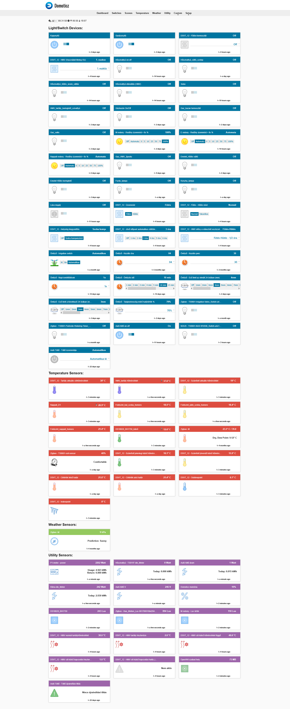
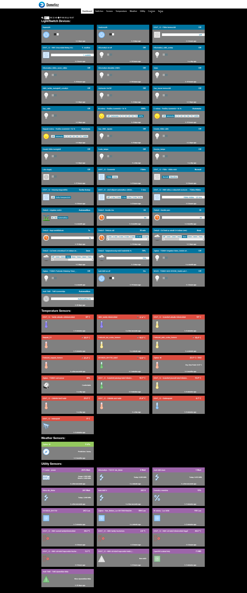

# Szélessáv Themes for Domoticz

**Light and Dark themes for Domoticz**, developed and maintained by [Szélessáv Műhely](https://www.szelessavmuhely.hu/), a project of the Szélessáv Public Benefit Foundation.

These themes provide an alternative interface for Domoticz, with customized dashboards, device icons, navigation elements, and improved visual styling.

Both themes can be used with a standard Domoticz installation. An optional configuration switch enables Szélessáv SmartHome branding and an additional website menu.

**Languages:** [English](#english-documentation) | [Magyar](#magyar-nyelvű-dokumentáció)

---

# English Documentation

## Screenshots

### Light Theme



### Dark Theme



## Features

- Light and Dark visual styles
- Customized dashboards and device icons
- Improved navigation and interface styling
- Support for standard Domoticz installations
- Optional Szélessáv SmartHome branding
- Additional website menu in Szélessáv firmware mode
- No additional server-side services required

## Installation

### 1. Download

Download the repository using **Code → Download ZIP**:

https://github.com/szelessavalapitvany/Domoticz-Szelessav-Themes

Extract the downloaded ZIP archive.

### 2. Copy the theme folders

Copy the `szelessav_light` and `szelessav_dark` directories into the Domoticz `www/styles/` directory.

The resulting structure should be:

```text
domoticz/
└── www/
    └── styles/
        ├── szelessav_light/
        └── szelessav_dark/
```

On our OpenWrt installations, the destination is:

```text
/usr/share/domoticz/www/styles/
```

The installation path may differ on other operating systems.

### 3. Select a theme

Open the Domoticz web interface.

Go to **Setup → Settings**, find the theme selection option, and choose one of the following:

- `szelessav_light` – Light Theme
- `szelessav_dark` – Dark Theme

Save the settings and reload the browser.

If the new appearance is not displayed correctly, perform a hard refresh (`Ctrl + Shift + R`) or clear the browser cache.

## Configuration

Each theme includes its own `theme.json` configuration file.

### Standard Domoticz installation

The default configuration is:

```json
"szelessav_firmware": false
```

In this mode:

- The original Domoticz logo and title are displayed.
- The Szélessáv logo is hidden.
- The Szélessáv website menu is disabled.
- The theme can be used independently of Szélessáv SmartHome firmware.

This is the recommended setting for standard Domoticz installations.

### Szélessáv SmartHome firmware

To enable Szélessáv branding, change the setting to:

```json
"szelessav_firmware": true
```

This automatically enables:

- The Szélessáv logo in the header
- The Szélessáv website navigation menu
- Hiding the original Domoticz logo and title

The website menu is controlled by the same configuration switch. No additional menu setting is required.

The Light and Dark themes have independent configurations.

## Updating

To update a theme:

1. Download the latest version from GitHub.
2. Back up any customized configuration files.
3. Replace the corresponding theme directory in your Domoticz installation.
4. Reload the Domoticz web interface.

If the previous theme appearance remains visible, clear the browser cache.

**Note:** Replacing the theme directory also replaces its `theme.json` configuration file. Restore any custom settings if necessary.

## Compatibility

The themes have been developed and tested with **Domoticz 2025.2**.

Other Domoticz versions may work, but compatibility has not been verified for this release.

## Feedback and Bug Reports

Bug reports, compatibility feedback, and improvement suggestions are welcome.

[Report an issue on GitHub](https://github.com/szelessavalapitvany/Domoticz-Szelessav-Themes/issues)

When reporting an issue, please include:

- Your Domoticz version
- The selected theme (Light or Dark)
- Your browser and operating system
- A description of the problem
- A screenshot, if relevant

## Project and Development

Developed and maintained by **Szélessáv Műhely – Szélessáv Közhasznú Alapítvány**.

Website: https://www.szelessavmuhely.hu/

GitHub: https://github.com/szelessavalapitvany

## License

License information for the themes and their included third-party components will be documented separately.

---

# Magyar nyelvű dokumentáció

## Szélessáv témák Domoticzhoz

**Világos és sötét megjelenésű témák a Domoticz otthonautomatizálási rendszerhez**, a [Szélessáv Műhely](https://www.szelessavmuhely.hu/) fejlesztésében.

A két téma átalakított kezelőfelületet, egyedi eszközikonokat, testreszabott vezérlőpultot és navigációs elemeket kínál.

A témák hagyományos Domoticz-telepítéssel is használhatók. A Szélessáv SmartHome firmware használatakor egyetlen kapcsolóval aktiválható a saját arculat és a weboldalmenü.

## Képernyőképek

### Világos téma (Light)


### Sötét téma (Dark)


## Főbb jellemzők

- Világos és sötét megjelenés
- Átalakított vezérlőpult és eszközikonok
- Testreszabott navigáció és kezelőfelület
- Használható hagyományos Domoticz-telepítéssel
- Opcionális Szélessáv SmartHome arculat
- Kiegészítő weboldalmenü a Szélessáv firmware-ben
- Nem igényel külön szerveroldali szolgáltatást

## Telepítés

### 1. Letöltés

A GitHubon a **Code → Download ZIP** lehetőséggel töltsd le a repozitóriumot:

https://github.com/szelessavalapitvany/Domoticz-Szelessav-Themes

Csomagold ki a letöltött ZIP-fájlt.

### 2. A témák bemásolása

Másold a `szelessav_light` és `szelessav_dark` könyvtárakat a Domoticz `www/styles/` könyvtárába.

A végeredmény:

```text
domoticz/
└── www/
    └── styles/
        ├── szelessav_light/
        └── szelessav_dark/
```

Az általunk használt OpenWrt-rendszereken a könyvtár:

```text
/usr/share/domoticz/www/styles/
```

Más operációs rendszeren az elérési út eltérhet.

### 3. A téma kiválasztása

Nyisd meg a Domoticz webes felületét.

A **Beállítások → Rendszerbeállítások** oldalon keresd meg a téma kiválasztására szolgáló beállítást, majd válaszd ki a kívánt témát:

- `szelessav_light` – világos téma
- `szelessav_dark` – sötét téma

Mentsd el a beállításokat, majd frissítsd a böngészőt.

Ha az új megjelenés nem töltődik be megfelelően, használj teljes frissítést (`Ctrl + Shift + R`), vagy töröld a böngésző gyorsítótárát.

## Beállítások

Mindkét téma saját `theme.json` konfigurációs fájllal rendelkezik.

### Hagyományos Domoticz-telepítés

Az alapértelmezett beállítás:

```json
"szelessav_firmware": false
```

Ebben az üzemmódban:

- Az eredeti Domoticz-logó és felirat jelenik meg.
- A Szélessáv-logó rejtve marad.
- A Szélessáv weboldalmenüje nem jelenik meg.
- A téma önállóan, a Szélessáv SmartHome firmware nélkül is használható.

Hagyományos Domoticz-telepítéshez ezt a beállítást javasoljuk.

### Szélessáv SmartHome firmware

A saját arculat bekapcsolásához módosítsd a beállítást:

```json
"szelessav_firmware": true
```

Ezzel automatikusan:

- Megjelenik a Szélessáv-logó a fejlécben.
- Elérhetővé válik a Szélessáv Műhely weboldalmenüje.
- Eltűnik az eredeti Domoticz-logó és felirat.

A weboldalmenüt is ez az egyetlen kapcsoló vezérli, nem szükséges külön bekapcsolni.

A Light és Dark téma beállításai egymástól függetlenek.

## Frissítés

A témák frissítéséhez:

1. Töltsd le a repozitórium legújabb változatát.
2. Készíts biztonsági másolatot az esetlegesen módosított konfigurációs fájlokról.
3. Cseréld le a megfelelő témakönyvtárat.
4. Frissítsd a Domoticz webes felületét.

Ha továbbra is a régi megjelenés látható, töröld a böngésző gyorsítótárát.

**Fontos:** A teljes témakönyvtár cseréje a `theme.json` fájlt is felülírja. Szükség esetén állítsd vissza az egyedi beállításokat.

## Kompatibilitás

A témákat **Domoticz 2025.2** alatt fejlesztettük és teszteltük.

Más Domoticz-verziókkal is működhetnek, de ezek kompatibilitását ennél a kiadásnál nem ellenőriztük.

## Hibabejelentés és javaslatok

Hibajelentéseket, kompatibilitási tapasztalatokat és fejlesztési javaslatokat szívesen fogadunk.

[Hibabejelentés a GitHubon](https://github.com/szelessavalapitvany/Domoticz-Szelessav-Themes/issues)

Hibabejelentéskor kérjük, add meg:

- A Domoticz verzióját
- A használt témát (Light vagy Dark)
- A böngésző és az operációs rendszer nevét
- A hiba rövid leírását
- Lehetőség szerint egy képernyőképet

## Fejlesztő

**Szélessáv Műhely – Szélessáv Közhasznú Alapítvány**

Weboldal: https://www.szelessavmuhely.hu/

GitHub: https://github.com/szelessavalapitvany

## Licenc

A témák és a felhasznált külső komponensek licencinformációit külön dokumentáljuk.
